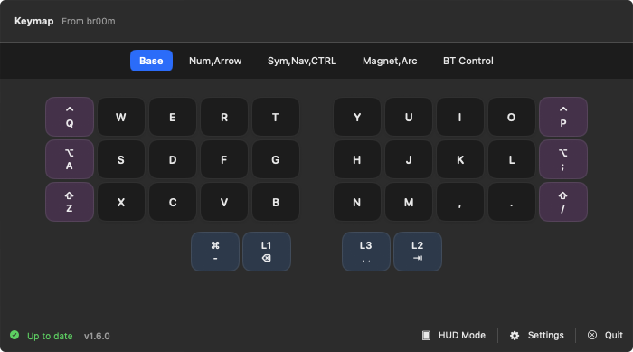
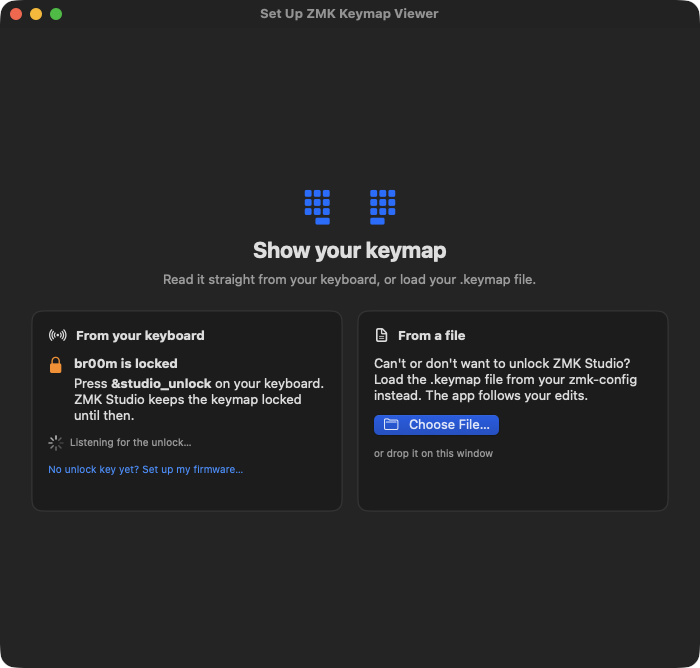
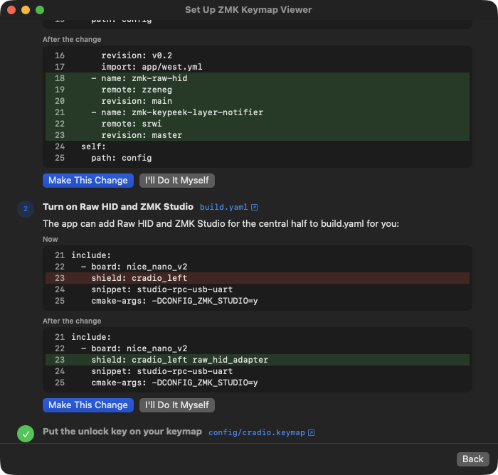
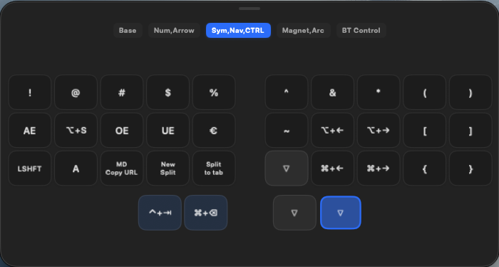
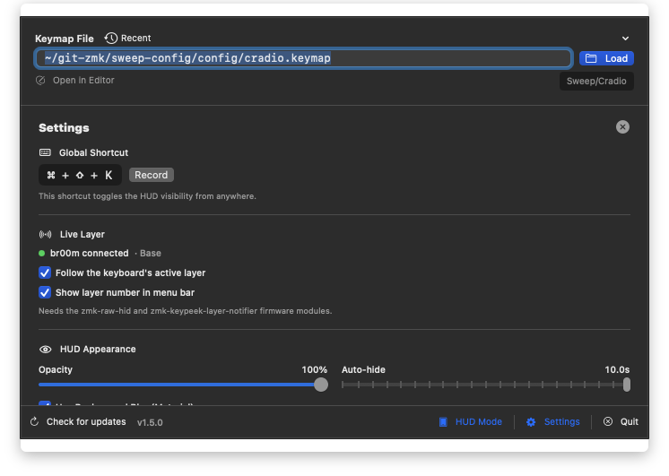

# ZMK Keymap Viewer

A lightweight macOS menu bar app that displays your ZMK keymap bindings in a visual 2D grid. Perfect for when you're learning a new layer or can't remember where you put that special key. It reads the keymap straight from your keyboard over ZMK Studio, or from your `.keymap` file.

With two small firmware modules it follows your keyboard live: it shows the layer you are on and lights up the keys you press, in a floating HUD that stays out of your way.




---

## ✨ Features

- 🎹 **Menu bar app** — Always one click away
- 🔄 **Layer switching** — Instantly switch between all your layers
- ⌨️ **Auto-detect layout** — Sweep, Corne, Sofle, Lily58, and more
- 👁️ [**HUD Mode**](#️-hud-mode) — Transparent floating overlay (toggle with `Cmd+Shift+K`, or a shortcut of your own)
- 📡 [**Live layer**](#-live-layer) — Follows the layer you're on, over USB or Bluetooth
- ✨ [**Key highlighting**](#-live-layer) — Keys light up in the HUD while you hold them
- 🔢 **Layer in the menu bar** — The menu bar icon shows the active layer number
- ⌨️ [**Keymap from the keyboard**](#keymap-straight-from-the-keyboard) — Reads the keymap over ZMK Studio, no file needed
- 🧭 [**Guided setup**](#-setup) — Gets your firmware ready, showing every change before it makes it
- 🔤 [**Typed characters**](#-key-names) — `⌥⇧2` shows as `€`, in your macOS keyboard layout
- 📝 [**Key names**](#-key-names) — Right-click a key to name shortcuts and macros
- 🔴 **Live reload** — Watches your keymap file for changes
- 📄 **PDF Export** — Export your layout to PDF
- 🔄 **Auto-update** — Checks for updates and downloads them in-app

---

## 📥 Installation

1. Go to [**Releases**](../../releases/latest)
2. Download `ZMK-Keymap-Viewer-vX.X.X.dmg`
3. Open the DMG and drag **ZMK Keymap Viewer** to Applications
4. **First launch:** The app is not notarized. If macOS refuses to open it or says it is damaged, open **System Settings → Privacy & Security** and click **Open Anyway**, or run:

   ```bash
   xattr -dr com.apple.quarantine "/Applications/ZMK Keymap Viewer.app"
   ```

> **Build from source:** `./scripts/build-release.sh` builds the app bundle and the DMG (the version comes from `appVersion` in `ZMKKeymapViewer.swift`).

---

## 🚀 Setup

There are two ways to get going. Start with the file if you just want to see your keymap; go for the full setup for everything the app can do.

| | **Quick start** | **Full setup with ZMK Studio** |
|---|---|---|
| You need | your `.keymap` file | two firmware modules and ZMK Studio, flashed once |
| You get | your keymap, the HUD, key names | all of it, plus the live layer, held keys lighting up, and the keymap read straight from the keyboard |
| Takes | a minute | about 15 minutes plus a firmware build |

On the first start the setup window opens by itself. Another keyboard or config later? **Settings → Live Layer → Set Up a Keyboard…** opens it again.



### Quick start: your `.keymap` file

1. Open the app. The setup window shows two ways to your keymap.
2. Under **From a file**, click **Choose File…** and pick your keymap, usually `config/<keyboard>.keymap` in your zmk-config. You can also drop the file on the window.
3. Done. Your keymap now lives in the menu bar: click the keyboard icon. When you edit the file, the app follows.

### Full setup with ZMK Studio

The app walks you through it and checks your zmk-config as you go: steps that are done get a green tick.

1. Open the app and click **Set up my firmware…** in the setup window.
2. **Choose your zmk-config**, the folder with `build.yaml`.
3. **Add the modules** to `config/west.yml`: [zmk-raw-hid](https://github.com/zzeneg/zmk-raw-hid) and [zmk-keypeek-layer-notifier](https://github.com/srwi/zmk-keypeek-layer-notifier), the same modules [KeyPeek](https://github.com/srwi/keypeek) uses. The app shows the change as *now* and *after*; **Make This Change** writes it.
4. **Turn on Raw HID and ZMK Studio** for the central half in `build.yaml`, the same way. Only the central half needs it.
5. **Put `&studio_unlock` on a key** in your keymap. ZMK Studio keeps the keymap locked until you press it. A good place is the layer with your Bluetooth keys; without a spare key, a combo works too. The app shows how.
6. **Build and flash:** commit and push your zmk-config, download the firmware from the build (on GitHub: the Actions tab) and flash the central half.
7. **Pair again:** remove the keyboard in **System Settings → Bluetooth** and connect it anew. macOS only sees the new connection after that.
8. **Press `&studio_unlock`.** The app listens and loads the keymap by itself. From then on it remembers it, so you unlock once, not after every restart.



The app only adds lines and values to your files and keeps your comments and everything else (nice!view, artifact names, …). Files it doesn't fully understand it leaves to you, with examples to copy. It never commits, pushes or flashes for you.

<details>
<summary>Doing the firmware changes by hand</summary>

1. Add the modules to `config/west.yml`:

   ```yaml
   manifest:
     remotes:
       - name: zzeneg
         url-base: https://github.com/zzeneg
       - name: srwi
         url-base: https://github.com/srwi
     projects:
       - name: zmk-raw-hid
         remote: zzeneg
         revision: main
       - name: zmk-keypeek-layer-notifier
         remote: srwi
         revision: master
   ```

2. Add the `raw_hid_adapter` shield and ZMK Studio to the central half in `build.yaml` (for splits only the central half needs it):

   ```yaml
   include:
     - board: nice_nano_v2
       shield: cradio_left raw_hid_adapter
       snippet: studio-rpc-usb-uart
       cmake-args: -DCONFIG_ZMK_STUDIO=y
   ```

3. Bind a key to `&studio_unlock` in your keymap.
4. Flash the central half, then remove the keyboard in System Settings → Bluetooth and pair it again.

</details>

---

## 🎹 Using It

- **Menu bar:** click the keyboard icon for your keymap. The icon shows the layer you are on.
- **Layers:** click a layer tab, or let the [live layer](#-live-layer) switch for you.
- **HUD:** press `Cmd+Shift+K` for the [floating HUD](#️-hud-mode). Is the shortcut taken already? Pick another one in **Settings → Global Shortcut → Record**.
- **Key names:** right-click a key to [name it](#-key-names), e.g. `⇧+⌘+4` → *Screenshot*.
- **PDF:** export your layout in **Settings → PDF Export**.
- **Editor:** **Settings → Editor** opens keymap and config files with a command like `code`.

### 👁️ HUD Mode



- **Always-on-top** floating overlay, toggled with `Cmd+Shift+K` (or your own shortcut)
- **Auto-fades** after inactivity, wakes on hover, on key presses and on layer changes
- **Stays visible while you hold a key**, so a held layer (`&mo`, `&lt`, `&mt`) stays on screen while you look for a key
- **Draggable** by the handle bar at the top, **resizable** from any edge or corner
- Customize opacity, blur and timeout in Settings

### 📡 Live Layer

With the [full setup](#full-setup-with-zmk-studio), the app knows what happens on your keyboard, over USB and Bluetooth and without any extra macOS permission:

- **Active layer:** the popover and the HUD switch to the layer you are on, and the menu bar icon shows its number.
- **Held keys:** keys light up in the HUD while you hold them, so you see at a glance which key you hit.
- **No flicker:** the HUD wakes on every key press, not only on layer changes, and doesn't fade while a key is held.

Clicking a layer tab still works; it holds until your next layer change on the keyboard. **Settings → Live Layer** shows whether the keyboard is connected and which layer it is on, and turns following the keyboard and the menu bar number off.



### Keymap straight from the keyboard

With ZMK Studio in the firmware, the app reads the keymap from the keyboard itself: layers, bindings and the physical layout. It always shows what is really on the board, including changes made in ZMK Studio, and it only reads; it never changes the keymap on the keyboard.

ZMK Studio stays locked until you press `&studio_unlock`. The app asks for it and listens, and keeps the keymap it read last: after the first unlock it shows up right away, even when the keyboard restarts locked (*From … · saved*). Turn reading from the keyboard off in **Settings → Live Layer** to use a file instead.

### 📝 Key Names

Keys that type a character show that character in your current macOS keyboard layout: `&kp LS(LA(N2))` shows **€** in the ABC layout, `&kp RA(S)` shows **ß**, and with the German layout the `SEMI` key shows **Ö**. Switching the input source updates the labels.

Shortcuts and macros type nothing, so they show their keys (`⇧+⌘+4`). **Right-click a key → Name This Key…** to give it a name you recognize. The name shows on every key with the same binding, whether the keymap comes from the keyboard or from a file.

---

## 🛠️ How It Works

The app parses your `.keymap` file and extracts:
- All layers defined in the `keymap {}` block
- Bindings like `&kp`, `&lt`, `&mt`, `&trans`, `&bt`, and custom behaviors
- Layer names from `label` or `display-name`

For the live layer it listens for the Raw HID reports of [zmk-keypeek-layer-notifier](https://github.com/srwi/zmk-keypeek-layer-notifier) (usage page `0xFF60`): a layer mask on every layer change and a key position on every press and release. The key position is the binding's index in the keymap, so highlighting needs no extra layout config.

---

## 🤝 Contributing

Ideas and PRs welcome! Some things on the radar:

- [ ] Windows/Linux support
- [ ] QMK support

---

## 🙏 Credits

The live layer builds on other people's open source work:

- [KeyPeek](https://github.com/srwi/keypeek) and [zmk-keypeek-layer-notifier](https://github.com/srwi/zmk-keypeek-layer-notifier) by [srwi](https://github.com/srwi): the firmware module and Raw HID protocol the viewer listens to
- [zmk-raw-hid](https://github.com/zzeneg/zmk-raw-hid) by [zzeneg](https://github.com/zzeneg): the Raw HID transport over USB and Bluetooth
- [ZMK Firmware](https://zmk.dev)

---

## 📄 License

MIT © Intersebbtor, see [LICENSE](LICENSE)
